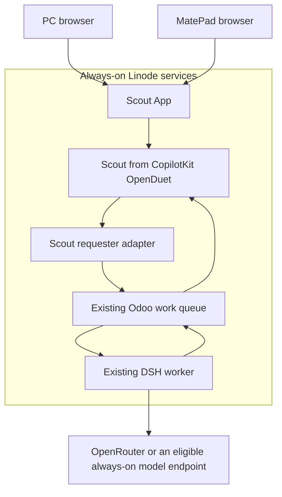

# Scout on Linode and MatePad

Prepared 2026-11-01 in response to the owner's deployment/design question.
Status: proposed deployment and acceptance plan; no workspace deployment or
shared access activation is claimed. Engineering record: [Issue #4](https://github.com/Nepritariel08/ssc-ai-enablement/issues/4#issuecomment-6547459663),
under architecture #8. The physical PC-off test remains deferred by the owner.

The later employee/customer requirement is governed by the
[enterprise architecture](SCOUT-ENTERPRISE-ARCHITECTURE.md) and
[foundation review](SCOUT-REPOSITORY-REVIEW.md). The Open Duet server sequence
below describes the historical Anil-matcha single-owner option. The owner's
latest direction selects **CopilotKit/OpenDuet**; LibreChat is superseded.
Use the [pivot contract](SCOUT-COPILOTKIT-PIVOT.md) for the active source and
dependency boundaries. Preserve the proven queue and native Scout capabilities.

## Current placement

| Component | Verified placement and limits |
| --- | --- |
| Scout workspace from Open Duet | Local Windows web backend, conversation database and review UI at `127.0.0.1:18081`. Accepted task5 and actual client-crash recovery task7 passed. This workspace is not yet served from Linode. |
| Community Odoo queue | Already on Linode; durable task state, requester, leases, result and acceptance. The existing private connector returned accepted task5 during this review. |
| DSH worker | Already active on Linode, under its own unprivileged account. Uses the existing queue and a separate inference profile; currently draft/analysis only, with no business-action tools. |
| Existing Scout/Odoo portal and AI Forge | Existing features remain under their owners. Adding the conversation workspace must preserve the current Home Menu and AI Forge. Their feature queues are not automatically replaced by this DSH queue. |
| PC and future MatePad client | Display, input and review devices. They must not become the durable task store or a requirement for remote execution. Actual MatePad browser/native compatibility has not been tested. |

The PC-off check is the remaining physical-device check in the bounded owner
pilot. It is not the only acceptance needed for server deployment or staff use.

## Proposed product boundary

Scout App is the user-facing product and navigation. Adopt CopilotKit OpenDuet's
tenant-package interface, port the old pilot's review/recovery contract, and
reuse the existing queue. Keep a protected deployment origin initially, with
verified sign-in and persistence before shared access. Preserve MIT attribution
in the CopilotKit fork and Apache-2.0 attribution for any old-pilot code reused.

Odoo remains authoritative for work state and acceptance. The central workspace
database holds conversations and mirrored task receipts. DSH executes claimed
work; it does not own the UI or user directory. GitHub owns source and review.
The diagram shows queued execution. Native chat can call an approved inference
endpoint directly; selecting native chat does not also submit a DSH task.
Do not enable a second routine, worker or scheduler for the same queued work.
An AI Forge/Discuss entry point must route a DSH request once with a stable
message key, rather than send it to both feature and DSH executors.

## Deployment sequence

1. **Private owner pilot on Linode.** Deploy this fork's workspace backend,
   static frontend and persistent conversation store as an isolated service,
   using the existing DSH worker and Odoo queue. Reconcile the live WI75 owner
   and obtain a bounded deployment claim before host changes. Select an exact
   build, target hostname, HTTPS proxy, service account, resource limits and
   rollback. Do not replace existing Odoo routes. Back up both application
   data and the protected encryption key; a database backup alone cannot
   decrypt saved engine credentials. Keep provider/requester keys on servers.
2. **Owner's MatePad browser access.** Use the central HTTPS workspace. Test
   layout, login, reconnect, task status, draft acceptance and cancellation on
   the actual tablet. A home-screen shortcut or installable PWA is a later
   client convenience, conditional on its browser/OS. No PWA manifest was
   found in the current frontend. Upstream's native mobile client is early
   source-only software, not a qualified MatePad package. The MatePad model,
   HarmonyOS/Android version and browser must be established before choosing
   native packaging or claiming device support.
3. **Staff pilot with individual identity.** Implement authentication,
   conversation isolation, per-user/company Odoo requester bindings and
   role-specific review/settings permissions before enabling staff access.
   Existing Odoo accounts can be the identity reference, but sign-in integration
   must be explicitly implemented and verified. A shared owner passphrase or
   fixed UID5 credential is not per-user authorization. Start with a small
   invited group, then qualify concurrency and wider rollout.

Do not run independent local and server conversation databases with the same
client ID. If migrating the existing workspace, stop its writer, back up data
and key material, restore and verify one authoritative instance. A fresh
independent workspace needs a distinct stable client ID. Local development may
continue with its own database and identity.

## Implementation gaps before staff access

- Upstream self-hosting is explicitly single-owner: paired devices act within
  that owner's scope, not as separate staff accounts. An authentication proxy
  alone does not add conversation or Odoo record isolation inside the app.
- The current queue engine accepts one protected `owner_id`/requester binding.
  Multi-account binding provisioning is not implemented. Its review endpoint
  is currently admin-scoped under the route allowlist; grant a narrow review
  permission rather than giving every staff member owner/admin access.
- The upstream hosted-sandbox preset currently disables `scout_queue` and
  OpenRouter. Hosting on our own Linux server does not require that preset.
  Any future multi-account server mode must explicitly support these safe
  requester/API adapters; do not bypass the hosted restrictions globally.
- Native chat and queued DSH inference have separate limits/configuration.
  Qualify each active route. A model hosted only on the Windows PC will be
  unavailable when that PC is off; use OpenRouter or an always-on endpoint
  for the independence test, and report route failures without silent fallback.

## Acceptance evidence

| Test | Required observation |
| --- | --- |
| Existing engineering pilot | Accepted task5, streaming/Stop/price/output-limit receipts, duplicate/isolation checks and task7 client-crash recovery remain valid bounded evidence. They do not establish multi-user or tablet readiness. |
| Central workspace persistence | Restart the new workspace service; recover the same conversation, task ID, encrypted configuration and draft. No local-PC API, database or model dependency. |
| Real PC-off path | Fully shut down Windows, then submit a new task from the MatePad through the central workspace. Observe the remote worker result and review it on the tablet; match server task timestamps and shutdown/startup evidence. This test remains deferred until the owner is ready. |
| Device/network recovery | Close the tablet browser, change network or briefly disconnect, then reopen. Recover the same task and draft without submitting another execution. |
| Identity and review rights | Two distinct staff users cannot read or mutate one another's conversations or unauthorized Odoo records. Verify allowed company, requester provenance, acceptance/cancel revision conflicts and denied settings access. |
| Operational recovery | Verify service/host restart, provider outage, bounded timeout/cancellation, uncertain-lease review without replay, and restoration of the new workspace's data plus encryption keys. Reuse existing worker recovery evidence where the deployed contract is unchanged. |
| Capacity and inference | Exercise the intended small-group concurrency, queue wait time, request/output/cost bounds and noisy-user isolation. An idle RAM/disk snapshot is not a capacity test. |

The existing queue owner's private connector acceptance and monitor already
have an owner. Coordinate the physical PC-off evidence in the same primary
tracker; do not create a duplicate worker, monitor or competing test countdown.

## Sources

- [Pinned fork authentication limits](AUTH.md#limits) and [self-hosting](SELF-HOSTING.md).
- [Requester binding and review contract](SCOUT-QUEUE.md).
- [Upstream mobile qualification](MOBILE.md).
- [Current DSH/Community queue boundary](https://github.com/Nepritariel08/ssc-ai-enablement/blob/feature/dsh-chatgpt-community-queue-20261101/docs/architecture/DSH-CHATGPT-COMMUNITY-QUEUE.md).
- [Browser PWA installation requirements](https://developer.mozilla.org/en-US/docs/Web/Progressive_web_apps/Guides/Making_PWAs_installable).
